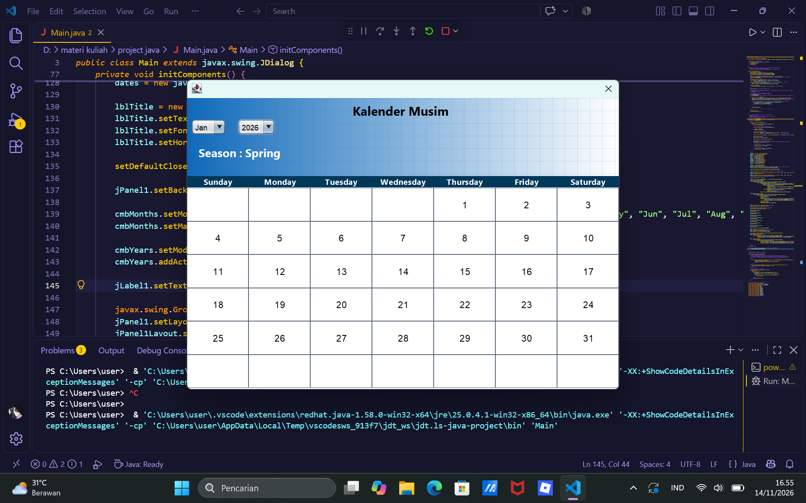

# Calendar Project

Aplikasi kalender desktop berbasis **Java Swing** yang menampilkan tanggal per bulan
dan musim (*season*) yang sedang berlangsung, lengkap dengan warna tema yang berubah
sesuai musim.

> Proyek Semester 1 — Praktikum Pemrograman Komputer



---

## Daftar Isi

- [Fitur](#fitur)
- [Prasyarat](#prasyarat)
- [Menjalankan Aplikasi](#menjalankan-aplikasi)
- [Struktur Proyek](#struktur-proyek)
- [Alur Kerja Program](#alur-kerja-program)
- [Menjalankan Test](#menjalankan-test)
- [Kontribusi](#kontribusi)
- [Tim Pengembang](#tim-pengembang)

---

## Fitur

- Pilih bulan dan tahun (1900–2100) lewat *combo box*.
- Saat dibuka, kalender langsung menampilkan bulan dan tahun hari ini.
- Hari Minggu ditandai dengan angka berwarna merah.
- Klik sebuah tanggal untuk melihat musimnya (Spring, Summer, Autumn, Winter).
- Warna bagian atas aplikasi berubah mengikuti musim.
- Tahun kabisat dihitung otomatis.

## Prasyarat

| Kebutuhan | Versi |
|-----------|-------|
| JDK       | 21 atau lebih baru |
| Maven     | 3.9+ (sudah termasuk di NetBeans & IntelliJ) |
| IDE       | Apache NetBeans (utama), IntelliJ IDEA, atau VS Code |

## Menjalankan Aplikasi

### Apache NetBeans (utama)

1. **File → Open Project…**, pilih folder `calendar-project` (ikon proyek Maven akan muncul).
2. Tekan **F6** atau tombol **Run Project** ▶.
3. Untuk mengubah tata letak GUI, buka `src/main/java/org/example/ui/CalendarFrame.java`,
   lalu pilih tab **Design**.

### IntelliJ IDEA

1. **File → Open…**, pilih folder `calendar-project`. IntelliJ akan mengenali `pom.xml` secara otomatis.
2. Buka `src/main/java/org/example/Main.java`, lalu klik ▶ di sebelah method `main`.

> File `.form` adalah format GUI Designer milik NetBeans. Di IntelliJ, ubah tampilan
> lewat kode biasa atau gunakan NetBeans untuk mengedit desainnya.

### Visual Studio Code

1. Buka folder `calendar-project`.
2. Pasang ekstensi yang direkomendasikan (muncul otomatis): **Extension Pack for Java**.
3. Buka tab **Run and Debug**, lalu pilih **Run Calendar App**.

### Terminal

```bash
mvn compile exec:java          # Menjalankan aplikasi
mvn package                    # Membuat file .jar di folder target/
java -jar target/Project_Calendar-1.0-SNAPSHOT.jar
```

## Struktur Proyek

Kode dipisah berdasarkan **tanggung jawab** supaya setiap file fokus pada satu tugas
dan mudah dipahami:

```
src/
├── main/java/org/example/
│   ├── Main.java                   ← Titik awal program: atur tema & buka jendela
│   │
│   ├── model/
│   │   └── Season.java             ← Daftar musim (enum)
│   │
│   ├── service/                    ← LOGIKA (tanpa GUI, bisa diuji otomatis)
│   │   ├── CalendarService.java    ← Menyusun tanggal ke kotak 6×7
│   │   └── SeasonCalculator.java   ← Menentukan musim dari sebuah tanggal
│   │
│   └── ui/                         ← TAMPILAN (Swing)
│       ├── CalendarFrame.java      ← Jendela utama: menghubungkan GUI dengan logika
│       ├── CalendarFrame.form      ← File desain GUI NetBeans (pasangan CalendarFrame.java)
│       ├── renderer/
│       │   ├── DayCellRenderer.java    ← Gaya kotak tanggal
│       │   └── DayHeaderRenderer.java  ← Gaya header nama hari
│       └── theme/
│           ├── AppTheme.java       ← Warna & font umum
│           └── SeasonTheme.java    ← Warna per musim
│
└── test/java/org/example/service/  ← Unit test untuk kelas di service/
    ├── CalendarServiceTest.java
    └── SeasonCalculatorTest.java
```

| Package   | Isi | Boleh memakai Swing? |
|-----------|-----|:--------------------:|
| `model`   | Data/tipe dasar | ❌ |
| `service` | Perhitungan & aturan bisnis | ❌ |
| `ui`      | Semua yang berhubungan dengan tampilan | ✅ |

Aturan sederhananya: **`service` tidak boleh tahu soal tampilan.** Karena itu logika
kalender bisa diuji tanpa membuka jendela.

## Alur Kerja Program

```
Main.main()
  └─▶ new CalendarFrame()
        ├─ initComponents()        buat komponen dari GUI Designer
        ├─ setup...()              atur gaya, isi combo box tahun
        └─ updateCalendar()
              ├─ CalendarService.buildMonthGrid()   → angka tanggal [6][7]
              ├─ salin ke JTable
              └─ refreshSeasonLabel()
                    ├─ SeasonCalculator.seasonOf()  → Season
                    └─ SeasonTheme.of()             → warna latar & tulisan

Pengguna ganti bulan/tahun  ──▶ updateCalendar()
Pengguna klik tanggal       ──▶ refreshSeasonLabel()
```

## Menjalankan Test

- **NetBeans:** klik kanan proyek → **Test** (Alt+F6)
- **IntelliJ:** klik kanan folder `src/test/java` → **Run 'All Tests'**
- **VS Code:** tab **Testing** (ikon tabung) → ▶
- **Terminal:** `mvn test`

## Kontribusi

Panduan alur kerja Git, aturan branch, dan cara sinkronisasi dengan repository asal
ada di [CONTRIBUTING.md](CONTRIBUTING.md).

## Tim Pengembang

- Dzaky Rozan
- Aisyah Amirah
- M. Fakhri Ismail
- Nadine Fissilmi Kaffa
- Gilland Ghazali Hartono
